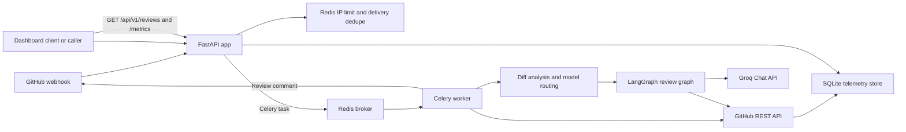
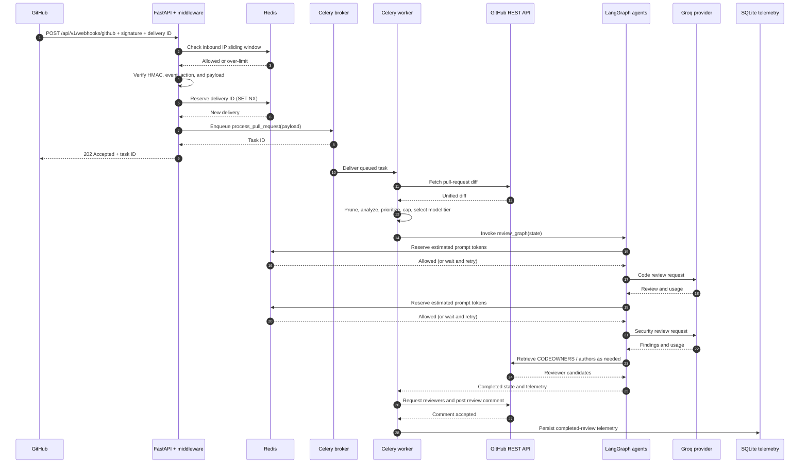

# MergeFlow Backend Architecture

MergeFlow is an asynchronous GitHub pull-request review backend. FastAPI
validates and enqueues incoming work; Celery workers retrieve pull-request data,
run a sequential LangGraph review workflow, publish a report to GitHub, and
persist completed-review telemetry in SQLite.

## System overview



Redis is used for the Celery broker/result backend, webhook delivery
deduplication, and distributed rate-limit state. Review telemetry is not stored
in Redis; it is persisted in SQLite.

## Module responsibilities

### FastAPI entrypoint and middleware

`app/main.py` creates the FastAPI application, installs
`IPRateLimitMiddleware`, mounts the webhook and dashboard routers under
`/api/v1`, and defines `/health`. The health route checks Redis connectivity.
The application lifespan closes the shared async Redis client during shutdown.

The middleware in `app/middleware/ip_rate_limiter.py` checks API requests
against a Redis sliding window before routing them to an endpoint. Its
configuration and Redis behavior are detailed in
[Resilience Patterns](./RESILIENCE_PATTERNS.md).

### Webhook ingestion

`app/api/webhooks.py` implements `POST /api/v1/webhooks/github`:

1. Requires a configured GitHub webhook secret and validates
   `X-Hub-Signature-256` against the exact raw request body using HMAC-SHA256 and
   constant-time comparison.
2. Requires `X-GitHub-Delivery`, and ignores non-pull-request events and
   actions other than `opened` and `synchronize`.
3. Validates the minimum repository and pull-request fields.
4. Reserves the delivery ID in Redis using an atomic `SET NX` operation; a
   previously reserved ID is acknowledged as a duplicate.
5. Enqueues `process_pull_request` through Celery and returns HTTP 202 with the
   task ID. If enqueueing fails, it attempts to release the deduplication
   reservation and returns HTTP 503.

This endpoint is called by GitHub, not by a dashboard form. GitHub must be
configured with the endpoint URL, secret, and pull-request event subscription.
The handler uses `asyncio.to_thread` for Celery enqueueing so synchronous
broker submission does not block the async request loop.

### Dashboard API

`app/api/dashboard.py` defines:

- `POST /api/v1/reviews`: accepts a normalized GitHub repository and positive
  pull-request number, loads PR metadata from GitHub, then enqueues the same
  Celery task as the webhook path. It returns HTTP 202 with `task_id`,
  `repository`, and `pull_number`.
- `GET /api/v1/reviews?limit=N`: returns recent completed review records,
  defaulting to 50 and allowing values from 1 through 500.
- `GET /api/v1/metrics`: returns aggregate counts, average latency, total
  tokens, and estimated savings.

Telemetry endpoint errors are logged and surfaced as HTTP 503. The API does
not currently expose a Celery task-status endpoint.

### Celery background worker

`app/workers/celery_worker.py` configures Celery with Redis as broker and
result backend. It enables late acknowledgements, worker-loss rejection,
prefetch of one task per worker slot, JSON serialization, task tracking, and
result expiry. `process_pull_request` invokes the async processing function
through `_run_with_fresh_loop`, which creates and drains a new event loop per
task. This is important because async HTTP clients are loop-bound and Celery
tasks may be retried or run sequentially within a worker process.

Transient exceptions are retried with bounded exponential backoff, jitter, and
up to five retries. `PermanentLLMError` is excluded from automatic retries.
The task returns repository, pull number, selected route, reviewer candidates,
truncation status, and workflow latency, but the API does not provide an HTTP
route to query that return value.

### Diff analysis and model routing

`app/services/github_client.py` retrieves the pull request diff and metadata.
`app/services/cost_router.py` prunes comment/blank changes, determines changed
paths and complexity, flags sensitive paths, caps the agent diff, and chooses
one of three tiers:

- Sensitive path or complexity score at least 150: `gemini_pro`
- Complexity score at least 40: `gemini_flash`
- Otherwise: `groq`

Despite the tier names, `app/services/llm.py` currently constructs `ChatGroq`
for all tiers and uses Groq-configured model names. The names express routing
and cost tiers, not provider selection in this implementation.

### LangGraph multi-agent workflow

`app/agents/graph.py` defines a sequential `StateGraph` over the
`ReviewState` TypedDict from `app/agents/state.py`:

```text
START
  -> code_reviewer
  -> security_scanner
  -> assignment_router
  -> END
```

- `code_reviewer.py` asks the model for actionable correctness,
  maintainability, and runtime findings.
- `security_scanner.py` asks for evidence-based security findings.
- Both nodes invoke the shared `invoke_agent` service and append usage/cost
  metadata to `telemetry`.
- `assignment_router.py` reads CODEOWNERS at the base ref, excludes the PR
  author, and falls back to recent file commit authors if no CODEOWNERS
  candidates remain. It limits candidates to five.

The graph is sequential: the security node runs after code review, and reviewer
assignment runs after both LLM nodes.

### Redis and rate-control services

`app/services/redis_client.py` exposes a cached async Redis client and helpers
for cache access and delivery reservations. The same Redis service also
supports:

- LLM token-bucket reservations through `app/services/rate_limiter.py`.
- Inbound request sliding-window state through
  `app/middleware/ip_rate_limiter.py`.
- Celery broker and result-backend traffic.

These are separate Redis keys and operations; rate-limit decisions are atomic
Lua scripts, while webhook deduplication uses Redis `SET` with `NX` and expiry.

### Persistence and telemetry

There are **no SQLAlchemy models or SQLAlchemy dependency in this repository**.
`app/services/telemetry_store.py` uses Python's built-in `sqlite3` module and
creates a `reviews` table on connection. The default database path is
`data/telemetry.sqlite3`, overridable with `TELEMETRY_DB_PATH`.

After GitHub accepts the completed review comment,
`GitHubClient.post_pr_comment` parses telemetry fields from the report and
records a completed row. Stored fields include repository, PR number, selected
model tier, latency, total tokens, estimated cost/savings, timestamp, and
status. Persistence failures are logged and do not reverse an already
successful GitHub comment.

The dashboard API reads aggregates and recent rows from this SQLite database.
Docker Compose mounts a shared telemetry volume for the web and worker
containers.

## End-to-end control flow

The following sequence starts with a GitHub webhook. Manual review submission
enters through `POST /api/v1/reviews` and converges on the same worker task
after first loading PR metadata.



Webhook responses acknowledge queueing, not completion. The review continues in
Celery after HTTP 202; the eventual completion signal in the current product is
the GitHub review comment and the completed row visible from the telemetry
endpoints.

## API surface

| Method | Path | Purpose | Successful response |
|---|---|---|---|
| `GET` | `/health` | Check Redis connectivity | `200 {"status":"ok"}` |
| `POST` | `/api/v1/webhooks/github` | Verified GitHub PR webhook | `202 {"status":"queued","task_id":"..."}` |
| `POST` | `/api/v1/reviews` | Queue manual review | `202` with task ID and PR identity |
| `GET` | `/api/v1/reviews?limit=50` | Read completed reviews | JSON array of records |
| `GET` | `/api/v1/metrics` | Read aggregate telemetry | JSON metrics object |

The `/api/` endpoints are subject to inbound Redis rate limiting. See
[Resilience Patterns](./RESILIENCE_PATTERNS.md) for limit, error, and proxy
behavior.
